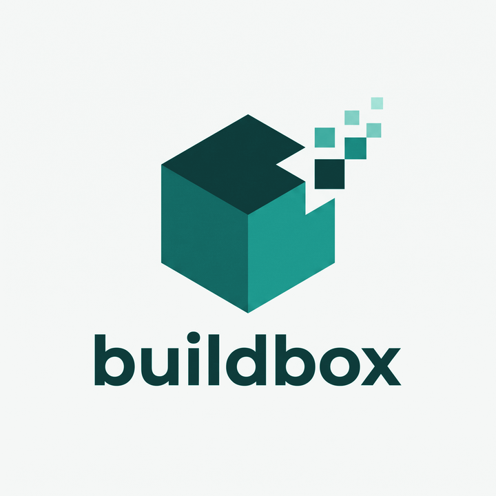
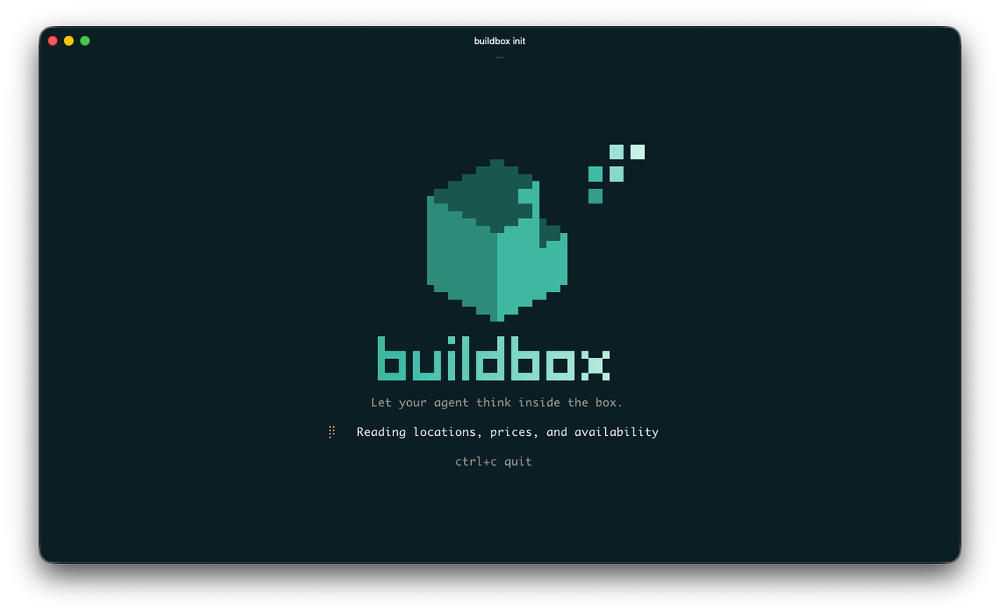
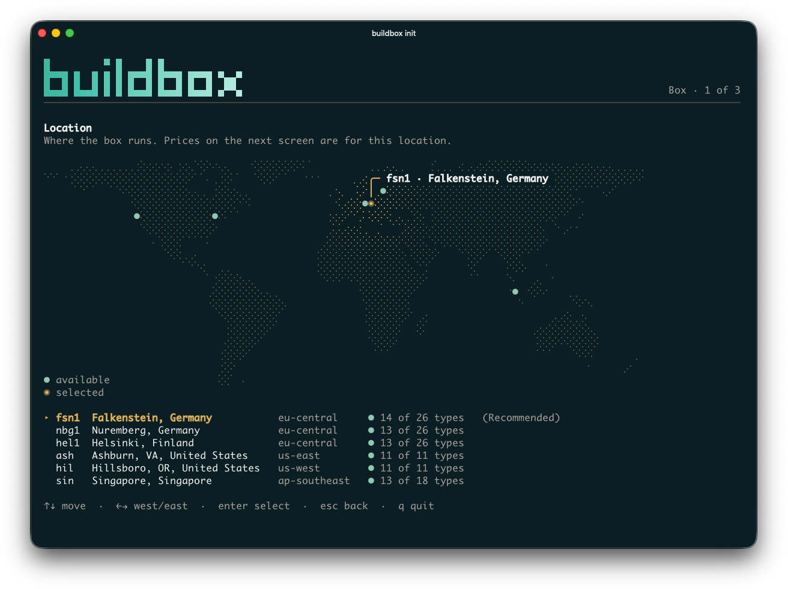
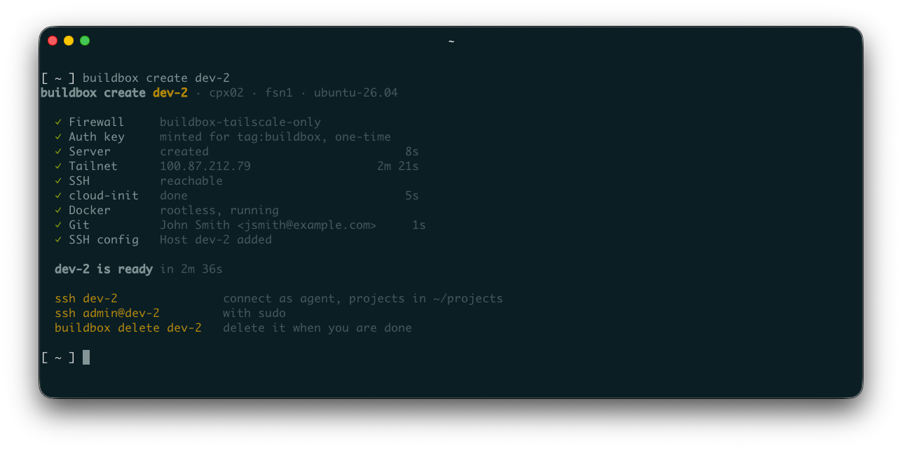
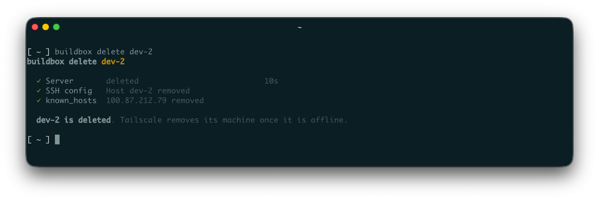
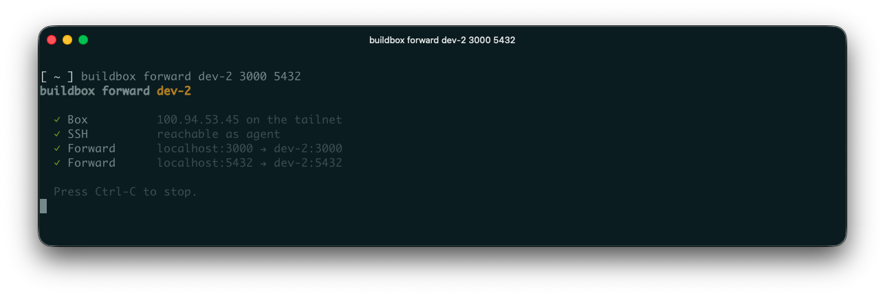

<h1 align="center">
  
</h1>

<p align="center">
  <em>Let your agent think inside the box.</em>
</p>

<p align="center">
  <strong>Spin up a disposable VPS for your coding agent, reachable only over Tailscale.</strong>
</p>

<p align="center">
  <a href="https://github.com/hkluke/buildbox/actions/workflows/check.yml"></a>
  <a href="go.mod"></a>
  <a href="LICENSE"></a>
</p>

buildbox gives a coding agent a machine of its own. One command creates a VPS
on Hetzner Cloud, joins it to your tailnet, and sets up an unprivileged `agent`
user with rootless Docker, Git access, and the coding CLIs you choose, such as
OpenCode, Claude Code, Codex, or Grok Build. The server accepts no traffic from
the internet except Tailscale's. You connect with `ssh <name>`, and `scp`,
`rsync`, and remote-SSH editors work the same way. `buildbox delete <name>`
throws it away.

- **The agent stays off your laptop.** It works on its own server, and your
  files, browser sessions, and cloud credentials are out of its reach.
- **Private by default.** The Hetzner Cloud Firewall and the host firewall both
  admit only Tailscale, and `create` refuses a firewall that allows more. Logins
  are decided by your tailnet policy, not by keys on the box.
- **No root for the agent.** The `agent` user has no sudo, and Docker runs
  rootless as that user.
- **Disposable.** Each box is an hourly-billed Hetzner server and an ephemeral
  Tailscale machine. Create one per task and delete it when the task is done.

## Requirements

- a Mac or Linux machine with OpenSSH
- Go 1.27 or later
- Tailscale, logged in as an admin of your tailnet
- a Hetzner Cloud
  [API token](https://docs.hetzner.com/cloud/api/getting-started/generating-api-token/)
  with read and write access, ideally for a project used only by buildbox

The [`hcloud`](https://github.com/hetznercloud/cli) CLI is the recommended
place for the Hetzner token: buildbox reads it from the CLI's active context,
so it stays out of your shell environment. Its
[setup guide](https://github.com/hetznercloud/cli/blob/main/docs/tutorials/setup-hcloud-cli.md)
covers installing it and storing the token with `hcloud context create`.
`HCLOUD_TOKEN` works too.

## Quick start

```bash
go install github.com/hkluke/buildbox@latest

buildbox init          # once: the config, your tailnet policy, the firewall
buildbox create dev    # a new box, ready in a few minutes
ssh dev                # log in as agent
buildbox delete dev    # when the task is done
```









## How it works

buildbox talks to Hetzner only to create and delete servers. Everything else,
including your logins, goes over your tailnet.

Each box:

- joins your tailnet tagged `tag:buildbox`
- accepts traffic only from Tailscale, through Hetzner's Cloud Firewall and a
  firewall on the box
- has no OpenSSH: you log in through Tailscale SSH. `ssh dev` works where you
  ran create, and `ssh agent@dev` from any of your devices
- runs Ubuntu with two users, `agent` and `admin`

The coding agent works as `agent`, which has no sudo. It gets rootless Docker,
your Git key, and the coding tools you chose. The tools are installed but not
signed in: you sign in on the box, and buildbox never sees those credentials.
`admin` has sudo.

A box comes with git, Docker, a C toolchain, and Python 3, and with no
language runtime. The agent installs the one a project needs in its own home,
or builds in a container. Packages from apt are for `admin`:

```bash
ssh admin@dev sudo apt install golang-go
```

## Tailnet policy

Boxes join your tailnet tagged, so your policy needs a few lines for them.
`buildbox init` adds them for you: generate an API access token on
[the keys page](https://console.tailscale.com/admin/settings/keys) with a
one-day expiry and paste it. `init` shows every change, writes nothing until
you confirm, and never stores the token. It also creates the OAuth client that
mints an auth key for each `create`.

These are the lines it adds:

```jsonc
"tagOwners": {
  "tag:buildbox": ["autogroup:owner"],
},
"acls": [
  {"action": "accept", "src": ["autogroup:owner"], "dst": ["tag:buildbox:*"]},
],
"ssh": [
  {"action": "accept", "src": ["autogroup:owner"], "dst": ["tag:buildbox"], "users": ["agent", "admin"]},
],
```

- The first lets you create auth keys for the tag.
- The second lets your devices reach boxes on every port.
- The third lets you log in as `agent` or `admin`. It is `accept` rather than
  `check` because `create` logs in without a browser at hand.

No rule names `tag:buildbox` as a source, so a box reaches nothing on your
tailnet, provided the default rule no longer lets `"*"` reach everything.
`init` offers to change its source to `autogroup:member`.

If you manage the policy from a Git repository, add the lines there yourself,
since `init` rewrites the file in Tailscale's formatting. On a tailnet you
share with others, put your own login in place of `autogroup:owner`.

## Commands

```text
buildbox init                     Write the config and create the firewall
buildbox create [NAME]            Create a build box
buildbox list [--json]            List build boxes (alias: ls)
buildbox price [--memory GB ...]  Show the prices of build boxes by type and location
buildbox forward NAME PORT...     Forward local ports to a box
buildbox delete NAME [--force]    Delete a build box (alias: rm)
```

`buildbox help <command>` describes each one. `list --json` and `price --json`
keep their keys stable for scripts.

`price` shows what every server type costs in each location, sold-out ones
marked, and `--cheapest` names the one that fits your cores, memory, and disk
for the least, and where. It needs a Hetzner token and nothing else, so it
works before `init`. Hetzner bills by the hour and caps a month at the monthly
price; `price` shows that cap unless you pass `--per hour`.

```bash
buildbox price --memory 16-32                             # every type with 16 to 32 GB, priced per location
buildbox price --cheapest --min-cores 4 --min-memory 16   # the cheapest box with 4 cores and 16 GB, and where
```

`forward` brings a port on the box, such as the agent's dev server or its
database, to `localhost` on this machine, each port as `LOCAL:REMOTE` or one
number for both sides, until Ctrl-C. It listens on localhost here and reaches
only localhost on the box.

```bash
buildbox forward dev 3000        # localhost:3000 here reaches port 3000 on dev
buildbox forward dev 3000 5432   # two ports in one session, same numbers on both sides
buildbox forward dev 3001:3000   # LOCAL:REMOTE: localhost:3001 here reaches port 3000 on dev, when 3000 is taken here
```



`delete` refuses a server without the label `buildbox=true` unless you pass
`--force`, so a typo cannot delete another server in your Hetzner project.

A box is billed by the hour until you delete it. If `create` fails, or you
press Ctrl-C, after the server exists, it prints the `delete` command.

## Configuration

`buildbox init` writes `~/.config/buildbox/config.toml`, and the OAuth client
to `credentials.toml` beside it with mode 0600. The config holds no secret, so
it can live in a dotfiles repository.
[`buildbox.toml.example`](buildbox.toml.example) is a complete, commented
config, and `buildbox help` lists the environment variables that override it.

While it loads, `init` asks the Go module proxy whether a newer buildbox has
been released, and if so shows the command that installs it. Set
`BUILDBOX_NO_UPDATE_CHECK=1` to turn that off.

## Security

Your tailnet policy lets only you log in to a box, as `agent` or as `admin`
(with sudo).

A box gets only the credentials it needs:

- a single-use Tailscale auth key (used once to join your tailnet, then no
  longer valid)
- the Git key you choose (ideally a dedicated one, such as a deploy key;
  `init` can generate it)

On your machine, buildbox keeps only the Tailscale OAuth client secret, in a
credentials file readable by you alone. It can create auth keys for
`tag:buildbox` and nothing else. The API access token you give `init` is
used for that run and never saved.

Tailscale removes a deleted box's node shortly after it goes offline. To
remove it at once, use the Machines page of the admin console.

## Development

```bash
git clone https://github.com/hkluke/buildbox.git
cd buildbox
make hooks    # once per clone: run make check before every commit
make check    # build, test, and lint
```

`make help` lists the other targets. Linting needs the `golangci-lint` version
pinned in [the CI workflow](.github/workflows/check.yml).

## License

[Apache 2.0](LICENSE)

buildbox is not affiliated with Hetzner, Tailscale, or the makers of the coding
tools it installs.
